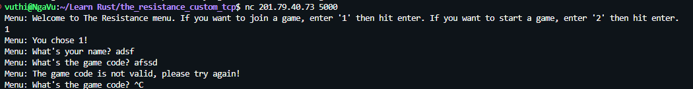
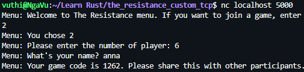

# The resistance

The game server is running on Digital Ocean. To play the game, simply open bash and connect to the Tcp server using netcat

1. Connect to the game
```shell
nc 201.79.40.73 5000
```

2. Choose the option: join a game or create a game


3. If you want to join a game (Option 1), please enter your name and a valid game code


4. If you want to create a game (Option 2), enter number of people and your name. You'll receive a game code to share with other participants.


5. Wait for everyone in the party to arrive so you can start the game.