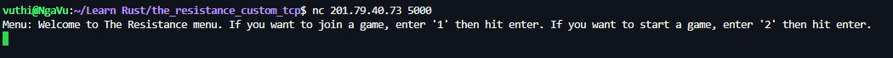

# The resistance

The game server is running on Digital Ocean. To play the game, simply open bash and connect to the Tcp server using netcat

1. Connect to the game
```shell
nc 201.79.40.73 5000
```

2. Choose the option: join a game or create a game


3. 